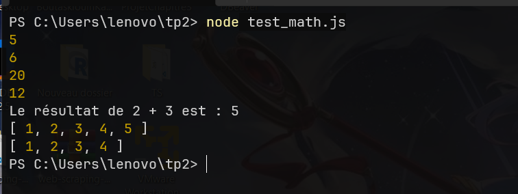
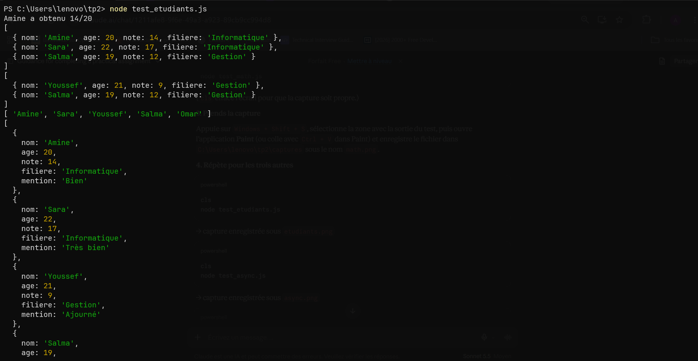
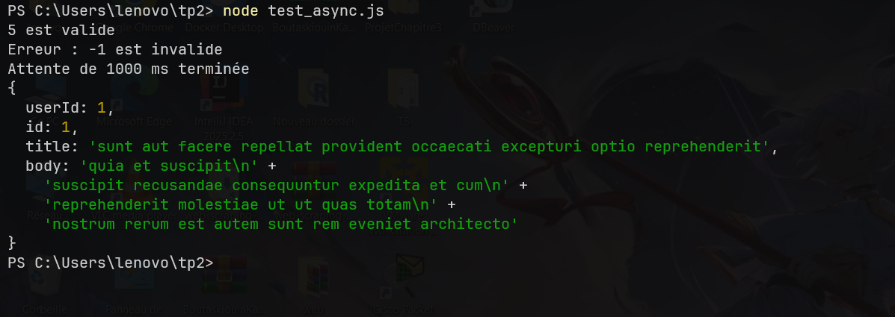
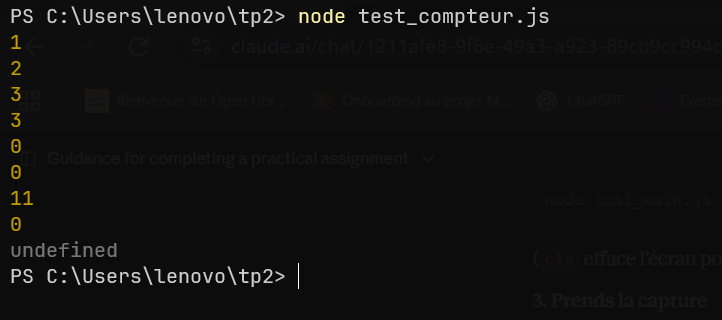

# TP2 : Mini-modules ES6+

**Auteur :** Kawtar BOUTASKIOUIN
**Encadrant :** Pr. Abdessamad Jarrar

## Prérequis
- Node.js 18 ou plus
- `"type": "module"` dans `package.json`

## Modules

| Module | Contenu | Test |
|---|---|---|
| `mod_math.js` | arrow functions, template strings, rest/spread | `node test_math.js` |
| `mod_etudiants.js` | destructuring, filter, map | `node test_etudiants.js` |
| `mod_async.js` | Promise, async/await, fetch | `node test_async.js` |
| `mod_compteur.js` | closure (compteur privé) | `node test_compteur.js` |

## Captures d'exécution

### mod_math.js

### mod_etudiants.js

### mod_async.js

### mod_compteur.js
